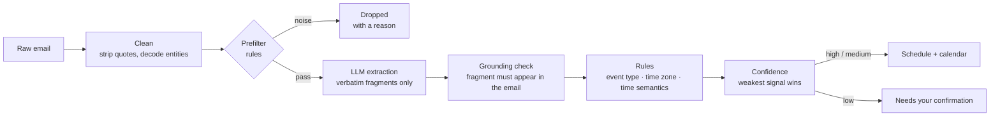

# Job Email Tracker

**Turns recruiting emails into a schedule you can trust.** It reads application receipts, assessment invites, interview notices and rejections, works out *what* each one is and *when* it happens (in which time zone), and puts it on a board. When it is not sure, it says so instead of guessing.

**Live demo:** https://job-command-center-eta-two.vercel.app
(All companies and emails in the demo are fictional. Everything runs in the browser.)

[中文说明](./README.zh-CN.md)

---

## Why this exists

During campus recruiting I was getting dozens of emails a week across two languages and four time zones. The costly mistakes are specific:

- A **fixed exam slot** read as a deadline → you miss the exam.
- A **deadline** read as a fixed slot → you sit waiting for something that never starts.
- A time shown in the **wrong time zone** → you are 12 hours off.
- An invite's *"this link becomes valid at 09:09"* read as the event time → the board says "overdue" the moment the email arrives.

A general-purpose LLM asked to "extract the date" makes all four, confidently. So the design goal is not "extract as much as possible". It is **never show a wrong time**.

## The core idea: the model extracts, rules decide



The LLM is only allowed to **copy fragments out of the email**: the company name, the role, the sentence that talks about time, a location, and a suggested event type. It never outputs a date, a time zone or a decision.

Everything that can hurt the user is decided by deterministic rules that can be read, tested and corrected one at a time:

| Decision | Made by | Why |
|---|---|---|
| Company / role / "which sentence is about time" | LLM | Rules are bad at free-form names; models are good at it |
| Is this fragment really in the email? | Rule (grounding check) | Blocks hallucinated dates and places |
| Fixed start vs. deadline vs. date-only | Rules | The most expensive mistake; must be explainable |
| Time zone | Rules, from explicit evidence only | Never inferred from language, never defaulted |
| Same event as an earlier email? | Rules (dedup key) | Reminders merge into the original instead of duplicating |
| Does it go on the schedule? | Rules (confidence) | "Uncertain" is a first-class outcome, not a failure |

Two properties follow from this split:

1. **The model has a veto but no vote.** If the model and the rules disagree about what an email is, the item goes to "needs confirmation". The model can keep something *off* the schedule; it can never put something *on* it.
2. **Every result is explainable.** Each card has a detail view showing the highlighted source fragments and the reason behind every step.

## Results on real email

Measured on 147 of my own recruiting emails (92 process emails, 50 job ads, 5 unrelated). Full method and caveats: [docs/EVALUATION.md](./docs/EVALUATION.md).

| | Rules only | Rules + model, first run | Rules + model, after fixes |
|---|---|---|---|
| **Precision** — items on the schedule that are fully correct (target > 95%) | 73.8% | 75.0% | **98.5%** |
| **Recall** — process emails that land on the schedule fully correct (target > 70%) | 33.7% | 55.4% | **72.8%** |
| Ads / unrelated email wrongly put on the schedule (of 55) | 3 | 8 | 1 |
| Company name correct (of 92) | 59.8% | 98.9% | 98.9% |

**Read this honestly:** the "after fixes" column is measured on the *same* 147 emails the fixes were written against, so it is optimistic. A fresh, unseen batch has not been scored yet. The first-run column is the uncontaminated number.

The first run is the interesting part: adding the model fixed company names almost completely (60% → 99%) but barely moved precision, because items that had been held back for "no company name" were now released onto the schedule *along with their other errors*. That is what led to the "veto, no vote" rule above.

## What the demo shows

| View | What it is |
|---|---|
| Schedule | One card per event: company, role, time in *your* time zone. Add, remove, delete. |
| Calendar | The same items on a month grid, placed by the viewer's local date. |
| Needs confirmation | Items the system would not guess on, each with a plain-language reason and three choices: schedule it, record it only, ignore it. |
| Applications | One row per company; status (applied → assessment → interview round → offer / rejected) inferred from the emails, manually overridable. |
| Stats | Funnel, status breakdown, the next two weeks, weekly volume, and how much the system handled without help. |
| Emails | Every email, including the ones that were ignored and why. |

The demo ships 28 synthetic emails. Thirteen are each built to exercise one specific failure mode (a fixed exam slot, a relative "within 72 hours" deadline, an "effective at" trap, an English email for an event in Hong Kong, an invite with no time zone, a reminder that must merge, and so on); the other fifteen are three weeks of ordinary history (receipts, a second-round and a final interview, an offer, rejections) so the applications table and the stats have something to show. Model output for these samples was recorded once and is replayed in the browser, so the public site makes no API calls.

## Repository layout

```
engine/   Parsing engine. Pure TypeScript, zero runtime dependencies. 461 tests.
web/      Next.js app (the demo). The engine is vendored into web/lib/tracker-core. 359 tests.
docs/     Evaluation method and numbers.
```

## Run it

Requires Node.js 20.9 or later (developed on Node 22).

```bash
# engine
cd engine
npm ci
npm test                 # 461 tests
npm run check            # type-check + tests with per-file coverage threshold

# web
cd web
npm ci
npm run dev              # http://localhost:3000
npm test                 # 359 tests
```

To use a real model instead of the recorded output, any OpenAI-compatible chat endpoint works:

```bash
cd web
export LLM_BASE_URL=https://api.deepseek.com/v1 LLM_MODEL=deepseek-v4-pro LLM_API_KEY=...
npx vite-node scripts/record-extractions.ts
```

To score the engine on your own mailbox, see `engine/tools/eval-extract.ts` and `engine/tools/score-extract.ts`. Keep your emails and their outputs out of version control.

## Known limitations

- **Not validated on unseen email yet.** See the note under the results table.
- **No backend.** Manual edits in the demo live in the browser's local storage. Connecting a real mailbox and persisting state server-side is the next step.
- **One promotional email still gets through** in the evaluation set: a campus-talk announcement that genuinely contains an on-site interview time. Both the rules and the model call it an interview.
- **"Conditional future" mentions.** A receipt that says "you will be invited to an assessment within 24 hours" is still classified as an assessment by the rules. It is now caught by the model's veto and held for confirmation, but the rule itself is not fixed.
- **Emails with no time-zone evidence** are held for confirmation by design, even when a human could guess the zone from the company.
- Source comments are in Chinese and occasionally reference internal design notes that are not part of this repository.

## What is not in this repository

Real emails, the hand-labelled truth set, and the regression tests that replay real emails are kept private. This repository contains code, synthetic data, and aggregate evaluation numbers only.

## How it was built

Built by one person working with an AI coding assistant (Claude). The product decisions, the invariants the engine must never break, and the acceptance of each change were mine; much of the code and the first-pass truth labelling were produced with the assistant. See [docs/EVALUATION.md](./docs/EVALUATION.md) for what that means for the numbers.

## License

MIT — see [LICENSE](./LICENSE).
