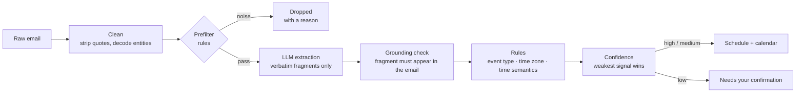

# Job Email Tracker

**Turns recruiting emails into a schedule you can trust.** It reads application receipts, assessment invites, interview notices and rejections, works out *what* each one is and *when* it happens (in which time zone), and puts it on a board. When it is not sure, it says so instead of guessing.

**Live demo:** https://job-command-center-eta-two.vercel.app
(All companies and emails in the demo are fictional. Everything runs in the browser.)

[中文说明](./README.zh-CN.md)

---

## Why this exists

During campus recruiting I was getting dozens of emails a week across two languages and four time zones. The costly mistakes are specific:

- A **fixed exam slot** read as a deadline → you miss the exam.
- A **deadline** read as a fixed slot → you sit waiting for something that never starts.
- A time shown in the **wrong time zone** → you are 12 hours off.
- An invite's *"this link becomes valid at 09:09"* read as the event time → the board says "overdue" the moment the email arrives.

A general-purpose LLM asked to "extract the date" makes all four, confidently. So the design goal is not "extract as much as possible". It is **never show a wrong time**.

## The core idea: the model extracts, rules decide



The LLM is only allowed to **copy fragments out of the email**: the company name, the role, the sentence that talks about time, a location, and a suggested event type. It never outputs a date, a time zone or a decision.

Everything that can hurt the user is decided by deterministic rules that can be read, tested and corrected one at a time:

| Decision | Made by | Why |
|---|---|---|
| Company / role / "which sentence is about time" | LLM | Rules are bad at free-form names; models are good at it |
| Is this fragment really in the email? | Rule (grounding check) | Blocks hallucinated dates and places |
| Fixed start vs. deadline vs. date-only | Rules | The most expensive mistake; must be explainable |
| Time zone | Rules, from explicit evidence only | Never inferred from language, never defaulted |
| Same event as an earlier email? | Rules (dedup key) | Reminders merge into the original instead of duplicating |
| Does it go on the schedule? | Rules (confidence) | "Uncertain" is a first-class outcome, not a failure |

Two properties follow from this split:

1. **The model has a veto but no vote.** If the model and the rules disagree about what an email is, the item goes to "needs confirmation". The model can keep something *off* the schedule; it can never put something *on* it.
2. **Every result is explainable.** Each card has a detail view showing the highlighted source fragments and the reason behind every step.

## Results on real email

Measured on 147 of my own recruiting emails (92 process emails, 50 job ads, 5 unrelated). Full method and caveats: [docs/EVALUATION.md](./docs/EVALUATION.md).

| | Rules only | Rules + model, first run | Rules + model, after fixes | + promotional filter |
|---|---|---|---|---|
| **Precision** — items on the schedule that are fully correct (target > 95%) | 73.8% | 75.0% | 98.5% | **100%** (67 / 67) |
| **Recall** — process emails that land on the schedule fully correct (target > 70%) | 33.7% | 55.4% | 72.8% | **72.8%** |
| Ads / unrelated email wrongly put on the schedule (of 55) | 3 | 8 | 1 | **0** |
| Ads / unrelated email sent to "needs confirmation" (of 55) | 14 | 13 | 11 | **2** |
| Company name correct (of 92) | 59.8% | 98.9% | 98.9% | 98.9% |

**Read this honestly:** the last two columns are measured on the *same* 147 emails the fixes were written against, so they are optimistic. A fresh, unseen batch has not been scored yet. The first-run column is the uncontaminated number. The promotional filter also has a cost: 2 process emails that used to wait in "needs confirmation" are now folded away as promotional (see [docs/EVALUATION.md](./docs/EVALUATION.md)).

The first run is the interesting part: adding the model fixed company names almost completely (60% → 99%) but barely moved precision, because items that had been held back for "no company name" were now released onto the schedule *along with their other errors*. That is what led to the "veto, no vote" rule above.

## What the demo shows

| View | What it is |
|---|---|
| Today | The next thing to do with a countdown, what is due in 48 hours, and what needs a follow-up. |
| Schedule | One card per event: company, role, time in *your* time zone, the assessment link / meeting ID on the card. Mark done; past items you have not marked are asked about ("did you do it?") instead of being assumed done. |
| Calendar | The same items on a month grid, placed by the viewer's local date. |
| Needs confirmation | Items the system would not guess on, each with a plain-language reason: schedule it, record it only, ignore it, or mark the sender as an ad. Bulk select. |
| Applications | One row per company; status inferred from the emails (receipts and results count here and nowhere else), editable. Bulk "followed up, check again in 7 days". Cards instead of a table on phones. |
| Stats | Funnel, status breakdown, the next two weeks, weekly volume, and how much the system handled without help. |
| Emails | Every email, newest first: relevant ones on top, ignored ones (ads, codes) folded below with the reason, deleted ones in a restorable trash. |
| Settings | What the board has learned from you (blocked senders, renamed companies, confirmed time zones), each removable; clear all changes. |

Across all views: edit any item (the original email is never changed), undo the last step (button or Ctrl/Cmd+Z), search, and confirm twice before anything irreversible.

The demo ships 28 synthetic emails. Thirteen are each built to exercise one specific failure mode (a fixed exam slot, a relative "within 72 hours" deadline, an "effective at" trap, an English email for an event in Hong Kong, an invite with no time zone, a reminder that must merge, and so on); the other fifteen are three weeks of ordinary history (receipts, a second-round and a final interview, an offer, rejections) so the applications table and the stats have something to show. Model output for these samples was recorded once and is replayed in the browser, so the public site makes no API calls.

## The private board (`worker/`)

The demo is the front end only. `worker/` is the server side I run for myself on Cloudflare (Workers + D1 + Email Routing), using the same engine and the same board component:

| Feature | How |
|---|---|
| Real email in | Gmail forwards recruiting mail to `jobs@<your domain>`; the Worker accepts it only from allow-listed forwarders, parses it with the engine (rules + model) and stores the result in D1. Your own replies are archived, not parsed. |
| Sign-in | Email one-time code (6 digits, 10 minutes, 5 attempts; per-email and per-IP rate limits; unknown addresses get the same answer so accounts cannot be enumerated), behind Cloudflare Turnstile. A password is kept as a fallback. Signed, HttpOnly session cookie. |
| Calendar subscription | A per-user `.ics` feed: subscribe once in Apple or Google Calendar and it keeps updating. Reminder lead times are a setting; the link can be rotated if it leaks. |
| AI quick add | Type one sentence ("interview with X next Tuesday 3pm"); the model extracts fragments, rules fill the form, you confirm. |
| AI interview prep | Generates likely questions for an interview from its emails and (optionally) your résumé, written into the item's notes with a label. The résumé (PDF/Word) is converted to text in the browser. |
| Forwarding guide | An illustrated how-to on the Emails page for setting up Gmail forwarding. |

Phase 1 has a single account (the owner); the tables are already keyed by user for multi-user later. Deploy steps and the security notes are in [worker/README.md](./worker/README.md) (Chinese). Before deploying, replace the placeholders in `worker/wrangler.toml` (domain, e-mail, database id) with your own.

## Repository layout

```
engine/   Parsing engine. Pure TypeScript, zero runtime dependencies. 485 tests.
web/      Next.js app (the demo). The engine is vendored into web/lib/tracker-core. 163 tests.
worker/   Cloudflare Worker: email intake, sign-in, calendar feed, AI endpoints, and the private board (Vite). 81 tests.
docs/     Evaluation method and numbers.
```

## Run it

Requires Node.js 20.9 or later (developed on Node 22).

```bash
# engine
cd engine
npm ci
npm test                 # 485 tests
npm run check            # type-check + tests with per-file coverage threshold

# web
cd web
npm ci
npm run dev              # http://localhost:3000
npm test                 # 163 tests
npm run check            # types + lint + tests + production build

# worker (install web first: the private board reuses its components)
cd worker
npm ci
npm run check            # types + 81 tests + board build
```

To use a real model instead of the recorded output, any OpenAI-compatible chat endpoint works:

```bash
cd web
export LLM_BASE_URL=https://api.deepseek.com/v1 LLM_MODEL=deepseek-v4-pro LLM_API_KEY=...
npx vite-node scripts/record-extractions.ts
```

To score the engine on your own mailbox, see `engine/tools/eval-extract.ts` and `engine/tools/score-extract.ts`. Keep your emails and their outputs out of version control.

## Known limitations

- **Not validated on unseen email yet.** See the note under the results table.
- **The demo has no backend.** Manual edits there live in the browser's local storage. The server side lives in `worker/` (see above).
- **Single account for now.** Cloudflare's free plan can only send sign-in codes to verified addresses, so the private board has one owner. Opening it to other users needs a paid sending path.
- **Promotional filtering is rule-based and in-sample.** Campus talks, live streams, job-board recommendations and "applications are open" mail are recognised from the subject line and folded; new marketing phrasings will slip through until a rule is added. The "mark as ad" button blocks a sender as a fallback.
- **"Conditional future" mentions.** A receipt that says "you will be invited to an assessment within 24 hours" is still classified as an assessment by the rules. It is now caught by the model's veto and held for confirmation, but the rule itself is not fixed.
- **Emails with no time-zone evidence** are held for confirmation by design, even when a human could guess the zone from the company.
- Source comments are in Chinese and occasionally reference internal design notes that are not part of this repository.

## What is not in this repository

Real emails, the hand-labelled truth set, and the regression tests that replay real emails are kept private. This repository contains code, synthetic data, and aggregate evaluation numbers only.

My own deployment's configuration (domain, e-mail addresses, database id, keys) is replaced with placeholders in `worker/wrangler.toml`. Secrets are never in the repository; they are set with `wrangler secret put`.

## How it was built

Built by one person working with an AI coding assistant (Claude). The product decisions, the invariants the engine must never break, and the acceptance of each change were mine; much of the code and the first-pass truth labelling were produced with the assistant. See [docs/EVALUATION.md](./docs/EVALUATION.md) for what that means for the numbers.

## License

MIT — see [LICENSE](./LICENSE).
